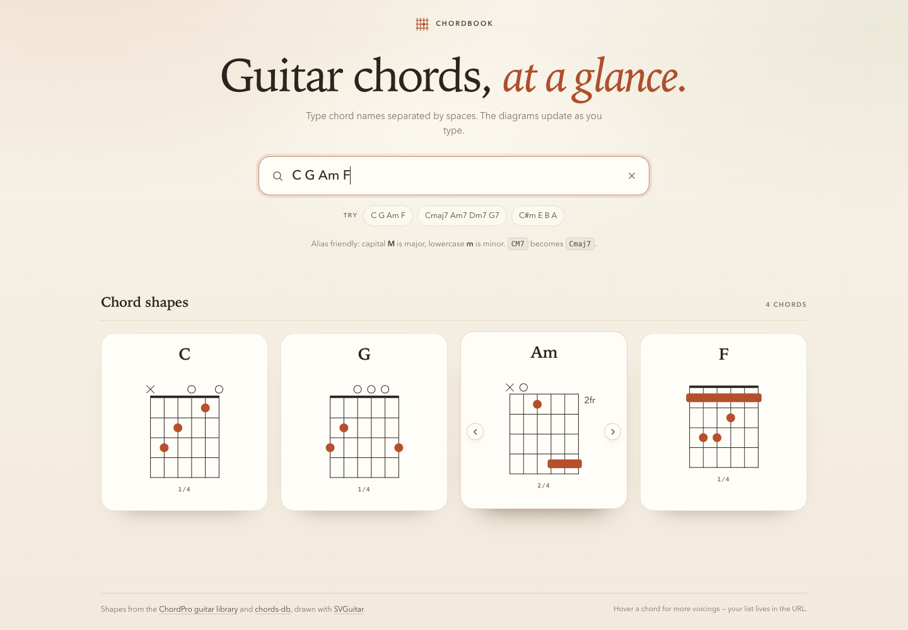

# Chordbook

A small guitar chord viewer built with React, TypeScript and Vite. Type a
space-separated list of chord names and the chord diagrams update as you type.
Hover a chord and use the chevrons to step through alternative voicings. The
current list and the selected voicings are kept in the URL, so the page can be
bookmarked or shared.



## Getting started

```bash
npm install
npm run dev
```

Open the URL printed by Vite. To create a production build:

```bash
npm run build
npm run preview
```

## Features

- **Live search** — no submit button; diagrams update on every keystroke.
- **Chord aliases** — `CM7` resolves to `Cmaj7`, `CM` to C major and `Cm` to C
  minor. Other common spellings such as `Cmin`, `C-7`, `CΔ7`, `C°`, `Cø` and
  `C+` are also understood.
- **Enharmonic roots** — `C#` and `Db`, `A#` and `Bb`, and other equivalents
  share shapes.
- **Chord variants** — every chord has several voicings. Hover a card to reveal
  small left/right chevrons and step through them; the counter underneath shows
  which shape you are looking at.
- **Shareable URLs** — e.g. `/?chords=C,G,Am,F` (the comma-separated value is
  URL-encoded as needed, so `C#` appears as `C%23`). Selected voicings are
  stored alongside it, e.g. `/?chords=C,G,Am,F&variant=1,0,0,2`.
- **Responsive layout** — diagrams are rendered with
  [SVGuitar](https://github.com/omnibrain/svguitar).

## Chord data

The default shape for each chord lives in `src/data/guitar.json` and comes from
the
[ChordPro guitar chord library](https://github.com/edonv/edonv.github.io/blob/master/js/json/guitar.json).
`src/lib/chords.ts` resolves aliases and indexes the shapes by pitch class, so
alternate spellings and enharmonic roots work automatically.

The extra voicings live in `src/data/variants.json`, generated from the
[chords-db](https://github.com/tombatossals/chords-db) guitar database (MIT).
`npm run variants` rebuilds that file from the pinned
`@tombatossals/chords-db` package and drops any position that does not spell the
chord it is filed under.

## Scripts

| Command             | Description                                |
| ------------------- | ------------------------------------------ |
| `npm run dev`       | Start the Vite dev server                  |
| `npm run build`     | Type-check and build                       |
| `npm run preview`   | Preview the production build               |
| `npm run lint`      | Run Oxlint                                 |
| `npm run variants`  | Regenerate `src/data/variants.json`        |

## Deployment

Pushing to `master` runs
`.github/workflows/deploy.yml`, builds the app, and deploys `dist` to GitHub
Pages. The workflow sets `VITE_BASE=/chordbook/` so assets resolve correctly
under the project Pages URL:

https://vince.id.au/chordbook/

(`https://vinceau.github.io/chordbook/` redirects there.)

You can also trigger the workflow manually from the Actions tab.
